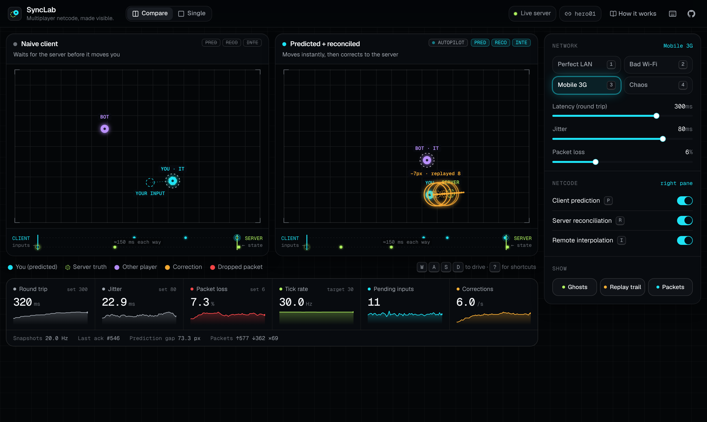
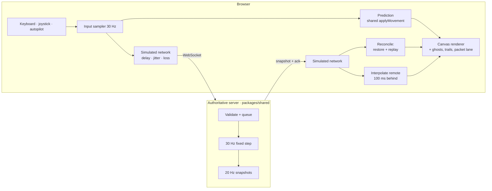

# SyncLab

**Multiplayer netcode, made visible.** A live lab where the netcode *is* the game. Client-side prediction, server reconciliation and snapshot interpolation run against latency, jitter and packet loss that you control. You can watch them work, side by side.

<!-- Hero GIF slot: replace the screenshot below with docs/hero.gif, an 8–10 s capture of Compare view switching from Bad Wi-Fi to Mobile 3G. -->


## What you're looking at

| On screen | What it means |
|---|---|
| **Two panes, one network** | Left is a naive client that waits for the server. Right predicts, reconciles and interpolates. Both get identical latency, jitter and loss. |
|  **Cyan disc** | You, drawn where *your client* thinks you are. |
|  **Lime ghost** | The last position the **server** confirmed. The server owns the truth. |
|  **Amber flash + dashed path** | A **reconciliation**: the client snapped to the server's answer and replayed the inputs it hadn't processed yet. The chip shows the distance and the replay count. |
|  **Violet disc** | The other player, **interpolated** 100 ms in the past between two snapshots. |
|  **Packet lane** | Every message in flight. Dot speed equals the simulated latency. Red bursts are lost packets. |

Thirty-second tour: open the site and press <kbd>Enter</kbd>. Press <kbd>3</kbd> (Mobile 3G) and drive with <kbd>W</kbd><kbd>A</kbd><kbd>S</kbd><kbd>D</kbd>. Then press <kbd>R</kbd> to turn off reconciliation and watch the right pane drift away from its lime ghost. Press <kbd>?</kbd> for every shortcut.

## Concepts demonstrated

- **Authoritative server.** Clients send sequenced *input directions*, never positions. The server owns movement, collisions and the tag state.
- **Fixed timestep.** The server runs an accumulator loop at 30 Hz with capped catch-up and sends snapshots at 20 Hz.
- **Client-side prediction.** The client applies the same shared `applyMovement` function the moment a key is pressed.
- **Server reconciliation.** Each snapshot acknowledges the last processed input. The client restores the authoritative position, drops acknowledged inputs and replays the rest.
- **Snapshot interpolation.** Remote players render 100 ms behind the estimated server clock, from an ordered, bounded snapshot buffer.
- **Network simulation.** Deterministic, seeded delay, jitter and loss are applied to whole application messages in both directions.
- **Observability.** Live RTT, RFC 3550 inter-arrival jitter, measured loss, tick rate, pending inputs and corrections per second, each with a sparkline.

## Architecture



The authoritative server (`RoomManager`, `FixedTimestepLoop` and message dispatch) lives in `packages/shared/src/server` behind a three-field socket interface. The **Node process** (`apps/server`) runs it behind `ws`. If the free-tier server is asleep, the **web app runs the identical code in the tab** behind a loopback socket, so the demo never shows a dead canvas. The same simulated network sits in front of both. The UI tells you which one you're on, and offers "Go live" once the remote server wakes.

```text
apps/
  web/                      Next.js 16 App Router UI
    src/features/lab/
      game-client.ts        prediction, reconciliation, interpolation, read-only telemetry
      network-simulator.ts  seeded delay/jitter/loss transport
      local-server.ts       loopback socket into the shared server (cold-start fallback)
      renderer.ts           arena canvas: entities, ghosts, correction effects
      packet-lane-renderer.ts
      use-lab-session.ts    client lifecycle + live/local fallback (external store)
      use-lab-input.ts      keyboard, joystick, demo autopilot
      components/           dock, panes, telemetry, tour, intro, overlays
    src/lib/                design tokens bridge (concepts.ts), motion tokens (motion.ts)
  server/                   Node + ws host for the shared authoritative server
packages/
  shared/                   protocol, guards, constants, simulation, reconciliation,
                            interpolation, and the authoritative server core
```

Rendering stays outside React. Each pane's `requestAnimationFrame` loop reads the `GameClient` directly. React only receives 4 Hz metrics. GSAP animates UI and overlay effects and never animates game entities.

## Running locally

Requirements: Node.js 20.9+ and pnpm 10+.

```bash
pnpm install
```

```bash
cp apps/web/.env.example apps/web/.env.local
```

```bash
pnpm dev
```

Open <http://localhost:3000>. The WebSocket server listens on `ws://localhost:8080`, with a health check at <http://localhost:8080/health>.

URL options: `?room=<id>` joins a room (open the same link in two tabs to play a real peer), `?server=local` or `?server=live` pins the server, and `?intro=0` skips the landing.

Checks:

```bash
pnpm typecheck && pnpm lint && pnpm test && pnpm build
```

## Design decisions

The full log, with reasons, is in [DECISIONS.md](DECISIONS.md). The audit that motivated it is in [AUDIT.md](AUDIT.md). The highlights:

- **Compare view by default.** The naive vs predicted comparison is the whole argument, so it's the first thing on screen, under the same network.
- **One color per concept, everywhere.** Cyan means you (predicted), lime the server, violet the remote player, amber a correction, red a drop. CSS variables are the single source, and the canvas reads them at runtime.
- **Measured next to configured.** Telemetry shows what was *observed* (for example RFC 3550 jitter) beside the slider value, which teaches that sliders are causes and cards are effects.
- **The demo drives itself.** An autopilot moves the player until you press a key, so a viewer who never touches the keyboard still sees prediction gaps and corrections.
- **Never a dead canvas.** The same authoritative code can run in the tab when the free-tier server is cold.
- **Motion with a budget.** GSAP is used for the intro, reveals, overlays, tweened numbers, preset glides and correction flashes, animating transforms, opacity and SVG attributes only. The production build holds 60 fps with every visualization on, and `prefers-reduced-motion` falls back to fades.
- **The netcode is untouched.** Tick rates, prediction, reconciliation, interpolation and the message format are unchanged. The visualizations read state and never steer it.

## Deployment

**Realtime server (Render, free tier).** Create a **New → Blueprint** from this repo. `render.yaml` builds `packages/shared` and `apps/server` and starts the server. Confirm that `/health` returns `{ "ok": true }`. The free service sleeps after 15 idle minutes. SyncLab falls back to the in-browser server and offers "Go live" once the service wakes.

**Web (Vercel).** Import the repository with the root as the project root, and `vercel.json` handles the build. Optionally set `NEXT_PUBLIC_WS_URL` (a `wss://` URL) and `NEXT_PUBLIC_SITE_URL` (for absolute Open Graph URLs), then redeploy.

## Robustness

- Runtime guards reject malformed, non-finite, out-of-range or unsafe-sequence messages. Payloads are capped at 16 KiB and connections at 120 messages per second.
- Input queues, pending input history, snapshot buffers, packet telemetry and correction records are all bounded.
- Reconnects use bounded exponential backoff and then fall back to the in-browser server.

## Limitations

- WebSockets run over TCP. SyncLab simulates application-message delay and loss for teaching. It doesn't model TCP retransmission or head-of-line blocking.
- Under heavy jitter, inputs can arrive out of order, and the server discards stale sequences. That is why corrections can outnumber dropped packets on Mobile 3G and Chaos.
- Rooms are in-memory on a single instance. The in-browser server is per-tab, so cross-device play needs the live server.
- There is no lag compensation for hit detection; the only interaction is a proximity tag.

## Case study

The longer write-up is [docs/case-study.md](docs/case-study.md).
